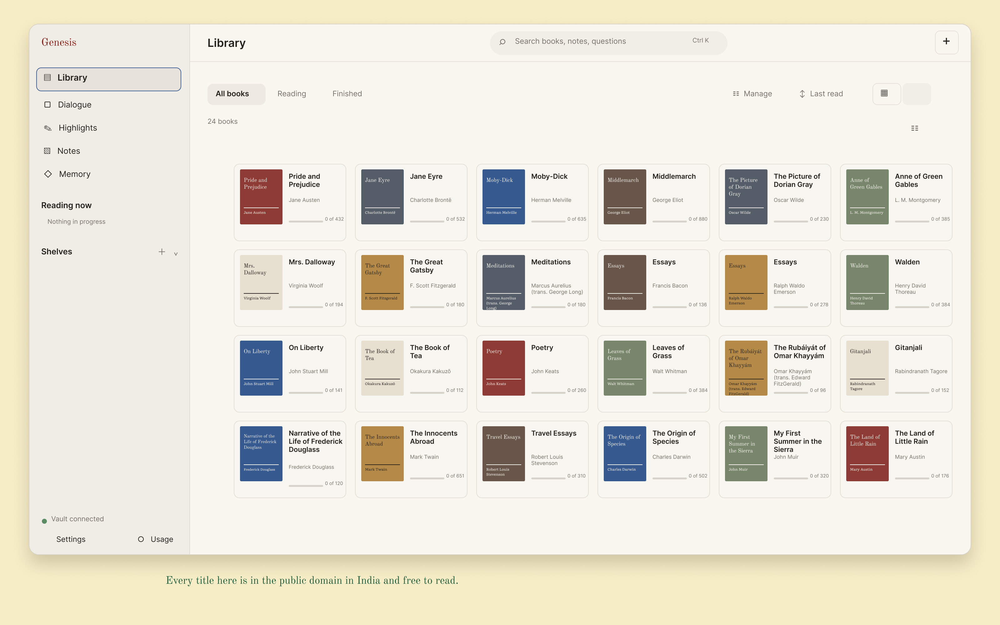

# Genesis

A quiet Windows reading app for PDFs and EPUBs, with highlights, margin notes, and a calm space to think.

Genesis is in **beta**. Some things may not work yet, and your feedback is how it gets better.

## What it does

- **Read without distractions** — Open PDFs and EPUBs in a warm paper view or dark mode.
- **Highlight and annotate** — Save highlights as real text (not screenshots) and write notes in the margin.
- **Think with your books** — Ask questions about any passage. Memory, which shows your connections, will be available in a future version.
- **Keep notes in your folder** — Sync your notes to an Obsidian vault folder you choose.

## Download and install

Genesis is for Windows only.

1. Download [**Genesis-Setup-0.2.1.exe**](https://github.com/aditduttawork-max/genesis-releases/releases/latest/download/Genesis-Setup-0.2.1.exe) from the Releases page.
2. Double-click the file to run the installer.
3. If Windows shows "Windows protected your PC," click **More info** and then **Run anyway**. Genesis is not yet code-signed, which is why Windows shows this warning.
4. On first launch, choose a folder on your computer for your notes.

## Your data

Your books, highlights, and notes are saved on your computer. Genesis has no account, no sign-in, and no analytics or crash reporting.

Some features send data out, and only when you use them:

- **Asking questions:** your passage and question go to the AI service you connect, such as Claude, ChatGPT or Gemini. You use your own account or API key with that service, and its privacy policy applies.
- **Finding books online:** searching or downloading from online libraries (Standard Ebooks, Internet Archive, Project Gutenberg, Open Library) connects to those sites.
- **Your notes folder:** Genesis writes notes to the folder you choose. Any syncing after that is done by your own tool, such as Obsidian or Google Drive.

## Feedback

Found a bug or have a thought to share? Send a note to adit.dutta.work@gmail.com.
## License

MIT License. Copyright (c) 2026 Aditya Dutta. See the [LICENSE](LICENSE) file for details.
